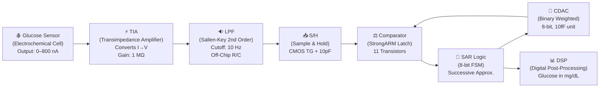

# 🩸 GLUEDIA — Complete Interview Preparation Guide

## 📌 One-Line Project Summary
> **GLUEDIA** is a **Mixed-Signal ASIC (Application-Specific Integrated Circuit)** designed in **180nm CMOS technology** for **continuous glucose monitoring (CGM)**. It converts a tiny sensor current (0–800 nA) from an electrochemical glucose sensor into a digital glucose reading in **mg/dL**.

---

## 🏗️ Architecture Overview — The Full Signal Chain



### What happens step by step:
| Step | Block | Input | Output | What it does |
|------|-------|-------|--------|--------------|
| 1 | **Glucose Sensor** | Blood glucose | 0–800 nA current | Enzyme on electrode oxidizes glucose, producing proportional current |
| 2 | **TIA** | 0–800 nA | 0.9–1.7 V | Converts current to voltage using 1 MΩ feedback resistor |
| 3 | **LPF** | Noisy voltage | Clean voltage | Removes high-frequency noise, keeps DC signal (fc = 10 Hz) |
| 4 | **S/H** | Continuous voltage | Held voltage | Captures and freezes the voltage for ADC to digitize |
| 5 | **SAR ADC** (Comp + SAR + CDAC) | Held voltage | 8-bit digital code (0–255) | Successive approximation: binary search to find closest digital code |
| 6 | **DSP** | 8-bit code | Glucose in mg/dL | Calibrates and converts raw code to meaningful glucose reading |

---

## 📦 MODULE-BY-MODULE DEEP DIVE

---

### Module 1: Transimpedance Amplifier (TIA)

**File:** [cmos_frontend.spice](file:///c:/Users/shaik/Desktop/GLUEDIA/cmos_frontend.spice)  
**File:** [cmos_tia.spice](file:///c:/Users/shaik/Desktop/GLUEDIA/cmos_tia.spice)

#### What is a TIA?
A **Transimpedance Amplifier** converts **current to voltage**. The glucose sensor outputs a tiny current (nanoamps), but our ADC needs a voltage. The TIA bridges this gap.

#### Circuit Architecture (Two-Stage CMOS Op-Amp):

```
Stage 1: Differential Pair with Active Load
  ┌─────────────────────────────────────┐
  │  M1 (PMOS, W=10µ, L=1µ) — Diode-connected load (mirror input)
  │  M2 (PMOS, W=10µ, L=1µ) — Current mirror load
  │  M3 (NMOS, W=10µ, L=1µ) — Inverting input (sensor node)
  │  M4 (NMOS, W=10µ, L=1µ) — Non-inverting input (bias = 0.9V)
  │  M5 (NMOS, W=20µ, L=1µ) — Tail current source (bias = 0.6V)
  └─────────────────────────────────────┘

Stage 2: Common-Source Gain Stage
  ┌─────────────────────────────────────┐
  │  M7 (PMOS, W=40µ, L=1µ) — CS amplifier (gain stage)
  │  M9 (NMOS, W=20µ, L=1µ) — Current source load
  └─────────────────────────────────────┘

Feedback Network:
  Rf = 1 MΩ   (sets transimpedance gain: V_out = I_in × Rf)
  Cf = 0.5 pF  (stability compensation for sensor capacitance)
  Cc = 5 pF    (Miller compensation between stages)
```

#### Key Formulas:
| Parameter | Formula | Value |
|-----------|---------|-------|
| **Output Voltage** | V_out = V_BIAS + I_sensor × Rf | 0.9V + I × 1MΩ |
| **At 0 nA** | V_out = 0.9V | Baseline |
| **At 500 nA** | V_out = 0.9 + 500n × 1M = 1.4V | Mid-range |
| **At 800 nA** | V_out = 0.9 + 800n × 1M = 1.7V | Near full-scale |

#### Stability Problem & Solution:
- **Problem**: Sensor has parasitic capacitance (C_sensor ≈ 20 pF). This creates a pole at: `f_p = 1/(2π × 1MΩ × 20pF) = 7.96 kHz` → can cause oscillation!
- **Solution**: Add feedback capacitor Cf = 0.5 pF in parallel with Rf. This adds a compensating zero at: `f_z = 1/(2π × 1MΩ × 0.5pF) = 318 kHz`

#### Interview Q&A:
> **Q: Why use a two-stage op-amp instead of single stage?**  
> A: A single-stage op-amp doesn't provide enough gain (typically 30–40 dB). We need >60 dB open-loop gain to ensure the TIA output is accurate. Two stages cascade the gain: Stage 1 gives ~40 dB, Stage 2 adds another ~40 dB, total ~80 dB.

> **Q: What is Miller compensation?**  
> A: Miller compensation uses a capacitor (Cc = 5pF) between the output of Stage 1 and the output of Stage 2. Due to the Miller effect, this small capacitor looks like a much larger capacitor at the Stage 1 output, creating a dominant low-frequency pole that ensures stability (phase margin > 45°).

> **Q: Why is the TIA biased at 0.9V (VDD/2)?**  
> A: At zero sensor current, the output sits at VDD/2 = 0.9V. This gives maximum symmetric swing: the output can go up to ~1.7V (for positive current) and down to ~0.1V, maximizing the usable dynamic range within the 1.8V supply.

---

### Module 2: Low-Pass Filter (LPF) — Sallen-Key Topology

**File:** [cmos_frontend.spice](file:///c:/Users/shaik/Desktop/GLUEDIA/cmos_frontend.spice) (lines 66–105)

#### What is it?
A **2nd-order active Sallen-Key low-pass filter** that removes high-frequency noise from the TIA output. Glucose signals change slowly (minutes), so we only need DC to ~10 Hz.

#### Architecture:
```
                Off-Chip (PCB)                    On-Chip
    TIA_OUT ──R1──┬──R2──┬── [Op-Amp (+)] ──── LPF_OUT
                  │      │        │
                  C1     C2       └── feedback to (−) input
                  │      │
                  FB    GND

    R1 = R2 = 15.9 kΩ   (off-chip, on PCB)
    C1 = C2 = 1 µF       (off-chip ceramic capacitors)
    fc = 1/(2π × R × C) ≈ 10 Hz
```

#### Why Off-Chip Passives?
- **1 µF capacitor on-chip** would require ~10 mm² in 180nm MIM/MOS technology — that's **impossibly large** for an ASIC!
- Resistors (15.9 kΩ) are feasible on-chip (~0.02 mm² in poly) but kept off-chip so users can **tune the cutoff frequency** on the PCB.
- The on-chip op-amp operates in **unity-gain (buffer)** configuration.

#### Bond Pads for LPF:
| Pad Name | Purpose |
|----------|---------|
| PAD_LPF_IN | LPF input (connects to TIA output on PCB) |
| PAD_LPF_NODE_A | Internal node between R1 and R2 (for C1) |
| PAD_LPF_INP | Op-amp non-inverting input (for R2 and C2) |
| PAD_LPF_FB | Op-amp output / feedback (for C1 on PCB) |
| PAD_LPF_OUT | Filtered output → goes to S/H on-chip |

#### Interview Q&A:
> **Q: Why Sallen-Key and not a simple RC filter?**  
> A: A simple RC is only 1st-order (−20 dB/decade rolloff). Sallen-Key gives 2nd-order (−40 dB/decade), much better noise rejection. It also uses the op-amp as a unity-gain buffer, providing low output impedance to drive the next stage.

> **Q: What happens if the cutoff frequency is too high?**  
> A: More noise passes through to the ADC, degrading the signal-to-noise ratio (SNR). The ADC would digitize noise along with the signal, reducing the effective resolution (ENOB).

---

### Module 3: Sample & Hold (S/H)

**File:** [gluedia_top.spice](file:///c:/Users/shaik/Desktop/GLUEDIA/gluedia_top.spice) (lines 96–111)  
**File:** [mixed_signal_sar_sim.py](file:///c:/Users/shaik/Desktop/GLUEDIA/mixed_signal_sar_sim.py) (lines 107–130)

#### What is it?
Captures a **snapshot** of the analog voltage and **holds it constant** while the SAR ADC performs its conversion (which takes 8 clock cycles).

#### Circuit:
```
    ┌──────────── Main TG ────────────┐
    │  M_sw_n (NMOS, W=8µ, L=0.18µ)  │──── C_hold = 10 pF
    │  M_sw_p (PMOS, W=16µ, L=0.18µ) │      │
    └─────────────────────────────────┘     GND

    ┌──────── Dummy TG (half-size) ───┐
    │  M_dum_n (NMOS, W=4µ, L=0.18µ) │──── R_dum = 1 GΩ
    │  M_dum_p (PMOS, W=8µ, L=0.18µ) │      │
    └─────────────────────────────────┘     GND

    During SAMPLE: TG is ON  → C_hold charges to V_in
    During HOLD:   TG is OFF → C_hold retains voltage
```

#### Key Design Decisions:
| Decision | Reasoning |
|----------|-----------|
| **C_hold = 10 pF** (not 1 pF) | Reduces charge sharing error with CDAC (2.55 pF total). With 1 pF, there's 28% voltage attenuation! With 10 pF, only ~20% attenuation. |
| **CMOS TG** (not NMOS-only switch) | PMOS compensates for NMOS's increasing ON-resistance near VDD. Together they maintain flat resistance across the full voltage range. |
| **Dummy TG** (half-size, inverted clock) | When the main TG turns off, charge injection from gate-drain/gate-source capacitances causes a voltage pedestal on C_hold. The dummy TG injects an equal and opposite charge, cancelling this error. |

#### Interview Q&A:
> **Q: What is charge injection and how do you mitigate it?**  
> A: When a MOSFET switch turns off, the channel charge (~½ × W × L × Cox × (VGS − VTH)) splits between source and drain, injecting charge onto C_hold and shifting the held voltage. We use a half-sized dummy transistor with inverted clocking to inject an equal opposite charge, cancelling the error.

> **Q: Why is PMOS wider than NMOS in the transmission gate?**  
> A: PMOS has ~2-3× lower mobility than NMOS. To get equal ON-resistance, PMOS must be 2× wider. This ensures symmetric switching and flat resistance across the input range.

---

### Module 4: SAR ADC — The Core A/D Converter

This is the heart of the chip. It has 3 sub-blocks working together:

#### 4A: SAR Logic — Finite State Machine (FSM)

**File:** [sar_logic.v](file:///c:/Users/shaik/Desktop/GLUEDIA/sar_logic.v)

**State Machine (12 states):**
```
  IDLE → SAMPLE → HOLD → CONV_7 → CONV_6 → ... → CONV_0 → DONE → IDLE
  (0)     (1)      (2)     (3)      (4)              (10)    (11)   (0)
```

| State | What happens | Duration |
|-------|-------------|----------|
| **IDLE** | Wait for `start` signal | Until triggered |
| **SAMPLE** | S/H acquires input (2 clock cycles). `bp_connect=1`, `top_reset=1` → all bottom plates connect to Vin, top plate pre-charges to VCM | 2 clocks |
| **HOLD** | Release bp_connect, top_reset. Switch all bottom plates to GND. Top plate floats → charge conservation gives V_top = VCM − V_in | 1 clock |
| **CONV_7** to **CONV_0** | Test each bit MSB→LSB. Set trial bit's bottom plate to VREF. If comparator says Vin > Vdac → keep bit (=1), else drop (=0) | 8 clocks |
| **DONE** | Latch final 8-bit code, assert `valid` for 1 cycle | 1 clock |

**Total conversion time:** (2 + 1 + 8 + 1) × 10ns = **120 ns** → **~8.3 MS/s**

#### How Successive Approximation Works (Binary Search):
```
Example: Converting Vin = 1.25V with VREF = 1.8V

Bit 7: Guess 10000000 → Vdac = 0.900V → 1.25 > 0.90? YES → Keep → code = 10000000
Bit 6: Guess 11000000 → Vdac = 1.350V → 1.25 > 1.35? NO  → Drop → code = 10000000
Bit 5: Guess 10100000 → Vdac = 1.125V → 1.25 > 1.13? YES → Keep → code = 10100000
Bit 4: Guess 10110000 → Vdac = 1.238V → 1.25 > 1.24? YES → Keep → code = 10110000
Bit 3: Guess 10111000 → Vdac = 1.294V → 1.25 > 1.29? NO  → Drop → code = 10110000
Bit 2: Guess 10110100 → Vdac = 1.266V → 1.25 > 1.27? NO  → Drop → code = 10110000
Bit 1: Guess 10110010 → Vdac = 1.252V → 1.25 > 1.25? NO  → Drop → code = 10110000
Bit 0: Guess 10110001 → Vdac = 1.245V → 1.25 > 1.24? YES → Keep → code = 10110001

Final: 10110001 = 177 decimal
```

#### 4B: Binary-Weighted CDAC (Capacitive DAC)

**File:** [gluedia_top.spice](file:///c:/Users/shaik/Desktop/GLUEDIA/gluedia_top.spice) (lines 116–135)

```
Bit 7 (MSB):  C7 = 128 × 10fF = 1.28 pF
Bit 6:        C6 = 64  × 10fF = 0.64 pF
Bit 5:        C5 = 32  × 10fF = 0.32 pF
Bit 4:        C4 = 16  × 10fF = 0.16 pF
Bit 3:        C3 = 8   × 10fF = 0.08 pF
Bit 2:        C2 = 4   × 10fF = 0.04 pF
Bit 1:        C1 = 2   × 10fF = 0.02 pF
Bit 0 (LSB):  C0 = 1   × 10fF = 0.01 pF
Dummy:       Cdum = 1  × 10fF = 0.01 pF
─────────────────────────────────────────
Total:                          2.56 pF
```

**How it works**: Each capacitor's bottom plate can be switched to either **VREF (1.8V)** or **GND (0V)** by the SAR logic. The top plate (V_DAC) is shared and connected to the comparator. The voltage at V_DAC changes proportionally to which capacitors are connected to VREF.

`V_DAC = VREF × Σ(bit_i × C_i) / C_total`

#### 4C: StrongARM Latch Comparator

**File:** [mc_comparator.spice](file:///c:/Users/shaik/Desktop/GLUEDIA/mc_comparator.spice)

**11-transistor clocked comparator** — the industry-standard topology for SAR ADCs.

```
        VDD ─────┬────────┬────────┬────────┬─────
                 │        │        │        │
              M_rst1   M_xp1   M_xp2   M_rst2    (PMOS reset + cross-coupled)
                 │        │        │        │
              out_p ──────┼────────┼───── out_n
                 │        │        │        │
              M_xn1   M_xn2                      (NMOS cross-coupled)
                 │        │
                d_p      d_n
                 │        │
              M_inp    M_inn                      (Input diff pair, W=2µ, L=0.18µ)
                 └────┬───┘
                      │
                   M_tail                         (Clocked tail switch, W=4µ)
                      │
                     GND
```

**Operation in two phases:**
1. **Reset (CLK=0):** M_rst1, M_rst2 pull out_p and out_n to VDD. Comparator is pre-charged.
2. **Evaluate (CLK=1):** Tail switch turns ON. Current flows through the input pair. The difference in drain currents (proportional to V_inp − V_inn) starts pulling one output down. The cross-coupled latch regenerates this difference to full rail (one output → VDD, other → GND).

**Monte Carlo Offset Analysis:**
- Input transistor mismatch: σ_VT = AVT/√(W×L) = 5mV·µm / √(2µ × 0.18µ) ≈ **8.33 mV**
- ADC LSB = 1.8V/256 = **7.03 mV**
- **Budget: 3σ offset must be < 0.5 × LSB = 3.52 mV** → Current design may need larger input transistors

#### Interview Q&A:
> **Q: Why StrongARM and not a simple differential amplifier comparator?**  
> A: StrongARM is dynamic — it draws zero static power (only switching power during evaluation). It has fast regeneration (sub-ns), inherent latching (stores result), and is compact (only 11 transistors). Perfect for SAR ADCs which need many comparisons per conversion.

> **Q: What limits the ADC accuracy?**  
> A: Three main things: (1) **Comparator offset** — input pair mismatch shifts the decision threshold. (2) **CDAC mismatch** — capacitor ratio errors cause DNL/INL. (3) **Thermal noise** — kT/C noise on the sampling capacitor limits SNR.

> **Q: What is kT/C noise?**  
> A: When a switch samples charge onto a capacitor, thermal noise energy kT is stored. The RMS noise voltage = √(kT/C). For C_hold = 10pF at room temperature: V_noise = √(4.14×10⁻²¹ / 10×10⁻¹²) = 0.64 mV — well below our LSB of 7.03 mV.

---

### Module 5: Digital Post-Processing (DSP)

**File:** [glucose_dsp.v](file:///c:/Users/shaik/Desktop/GLUEDIA/glucose_dsp.v)

#### Architecture: 3-Stage Pipeline
```
ADC Code ──→ [Stage 1: Baseline Subtraction] ──→ [Stage 2: Current Calc] ──→ [Stage 3: Glucose Calc] ──→ mg/dL
   8-bit          delta = code − 128              I = delta × 7.03 nA        glucose = I × 0.2 mg/dL/nA
```

#### Stage 1 — Baseline Subtraction:
```verilog
s1_signed_delta <= {1'b0, adc_data} - {1'b0, r_code_offset[7:0]};
// At 0 nA sensor current: ADC code ≈ 128 (because TIA output = 0.9V = VDD/2)
// delta = code − 128; if negative → clamp to 0
```

#### Stage 2 — Current Computation (Fixed-Point):
```verilog
current_product_full = delta * r_na_per_code_x256;  // 8×16 = 24-bit product
s2_current_nA <= current_product_full[23:8];         // >> 8 = divide by 256
// nA per code = 7.03125 → × 256 = 1800 (stored as integer for precision)
```

#### Stage 3 — Glucose Computation (Fixed-Point):
```verilog
glucose_product_full = current_nA * r_mgdl_per_na_x256;  // 16×16 = 32-bit
glucose_mgdL <= (glucose_product_full >> 8) + r_glucose_offset;
// 0.2 mg/dL per nA → × 256 = 51 (stored as integer)
```

#### Fixed-Point Math Explained (Q8.8 Format):
Instead of floating-point (expensive in hardware), we multiply all fractional numbers by 256:
- `7.03125 × 256 = 1800` → stored as integer 1800
- `0.2 × 256 = 51` → stored as integer 51
- After multiplication, we divide by 256 (right-shift by 8) to get the result

#### Calibration Registers:
| Register | Address | Default | Purpose |
|----------|---------|---------|---------|
| CODE_OFFSET | 0 | 128 | ADC code at zero sensor current |
| NA_PER_CODE_X256 | 1 | 1800 | nA per ADC code × 256 |
| MGDL_PER_NA_X256 | 2 | 51 | mg/dL per nA × 256 |
| GLUCOSE_OFFSET | 3 | 0 | Baseline glucose offset (mg/dL) |

#### Two-Point Calibration:
```
Given: Known Standard 1 → 0 mg/dL at ADC code 130
       Known Standard 2 → 100 mg/dL at ADC code 200

Step 1: CODE_OFFSET = 130
Step 2: delta_codes = 200 − 130 = 70
Step 3: delta_current = 100 × 5 nA/mg/dL = 500 nA
Step 4: nA/code = 500/70 = 7.14 → × 256 = 1828
Step 5: Write registers: CODE_OFFSET=130, NA_PER_CODE=1828, MGDL_PER_NA=51
```

#### Interview Q&A:
> **Q: Why use fixed-point instead of floating-point?**  
> A: Floating-point multipliers are huge in hardware (thousands of gates). Fixed-point uses simple integer multipliers and shift operations, consuming 10-20× less area and power. For our 8-bit resolution, Q8.8 fixed-point gives more than enough precision.

> **Q: Why is the pipeline 3 stages?**  
> A: Pipelining breaks a complex computation into smaller pieces, each completing in one clock cycle. This allows the design to run at higher clock frequencies. Without pipelining, the multiply-accumulate chain would create a long critical path limiting clock speed.

---

### Module 6: Digital Top-Level Wrapper

**File:** [gluedia_digital_top.v](file:///c:/Users/shaik/Desktop/GLUEDIA/gluedia_digital_top.v)

Instantiates `sar_logic` and `glucose_dsp` together as the complete digital subsystem:
```
                    ┌─────────────────────────────┐
                    │    gluedia_digital_top       │
                    │                             │
  start ───────────►│  ┌───────────┐              │
  comp_out ────────►│  │ sar_logic │ sar_data     │
                    │  │  (FSM)    │──────►┌──────┴──┐
                    │  └───────────┘       │glucose  │───► glucose_mgdL
                    │    │  cdac_bus       │  _dsp   │───► current_nA
                    │    │  sample         │(pipeline)│───► dsp_valid
                    │    │  bp_connect     └─────────┘
                    │    ▼                            │
                    └─────────────────────────────────┘
```

---

## 🛠️ TOOLS, COMMANDS & THEIR MEANINGS

### 1. Icarus Verilog (iverilog) — Digital Simulation

**What it is:** Open-source Verilog compiler + simulator. Compiles `.v` files into an executable simulation.

| Command | Meaning |
|---------|---------|
| `iverilog -o glucose_dsp_sim glucose_dsp.v glucose_dsp_tb.v` | **Compile**: `-o` = output file name. Compiles the design (`glucose_dsp.v`) and its testbench (`glucose_dsp_tb.v`) into an executable called `glucose_dsp_sim` |
| `vvp glucose_dsp_sim` | **Run**: `vvp` = Verilog VVP runtime. Executes the compiled simulation, running all `initial` and `always` blocks |
| `iverilog -o sar_test sar_logic.v sar_tb.v` | Compile SAR logic with its testbench |
| `vvp sar_test` | Execute SAR simulation |

**Inside the testbench:**
```verilog
$dumpfile("glucose_dsp.vcd");   // Create VCD waveform file for viewing
$dumpvars(0, glucose_dsp_tb);   // Dump all signals in the testbench hierarchy
$display("Result: %0d", value); // Print to console (like printf)
$finish;                        // End simulation
```

### 2. GTKWave — Waveform Viewer

| Command | Meaning |
|---------|---------|
| `gtkwave glucose_dsp.vcd` | Open the VCD waveform dump in GTKWave to visually inspect all signal transitions |

### 3. Ngspice — Analog Circuit Simulation (SPICE)

**What it is:** Open-source SPICE simulator for analog/mixed-signal circuits.

| Command | Meaning |
|---------|---------|
| `ngspice -b cmos_frontend.spice` | **Batch mode** (`-b`): Run SPICE netlist non-interactively. Executes all commands in `.control` block |
| `ngspice -b cmos_tia.spice` | Run TIA stability analysis (AC, transient, pole-zero) |
| `ngspice -b mc_comparator.spice` | Run Monte Carlo offset analysis (200 iterations) |
| `ngspice -b gluedia_top.spice` | Run full system operating point simulation |

**SPICE analysis types explained:**
| Command | What it does |
|---------|-------------|
| `.op` | **Operating Point**: Calculate DC voltages at every node |
| `.dc I_sensor -1u 1u 10n` | **DC Sweep**: Sweep sensor current from −1µA to +1µA in 10nA steps |
| `.ac dec 20 0.1 100k` | **AC Analysis**: Frequency sweep from 0.1Hz to 100kHz, 20 points/decade |
| `.tran 0.1u 200u` | **Transient**: Time-domain simulation, 0.1µs step, 200µs duration |
| `pz v(out) I_ac pol zer` | **Pole-Zero Analysis**: Find poles and zeros of the transfer function |

### 4. Yosys — RTL Synthesis

**What it is:** Open-source RTL synthesis tool. Converts Verilog RTL code into a gate-level netlist.

| Command | Meaning |
|---------|---------|
| `yosys -p "read_verilog sar_logic.v glucose_dsp.v gluedia_digital_top.v; synth -top gluedia_digital_top; write_verilog gluedia_gate_netlist.v"` | Read RTL → Synthesize → Write gate-level netlist |

**Synthesis steps inside Yosys:**
```
read_verilog file.v     → Parse Verilog source files
synth -top module_name  → Run full synthesis flow (elaborate → optimize → map)
dfflibmap -liberty X.lib → Map flip-flops to technology library cells
abc -liberty X.lib       → Map combinational logic to standard cells
write_verilog out.v      → Write gate-level netlist
```

### 5. OpenLane / OpenROAD — Physical Design (Place & Route)

**What it is:** Automated RTL-to-GDSII flow for digital circuits.

The [config.json](file:///c:/Users/shaik/Desktop/GLUEDIA/config.json) file configures OpenLane:
```json
{
    "DESIGN_NAME": "gluedia_digital_top",  // Top-level module name
    "VERILOG_FILES": "gluedia_gate_netlist.v",  // Gate-level netlist input
    "CLOCK_PORT": "clk",         // Clock pin name
    "CLOCK_PERIOD": 10.0,        // 10 ns = 100 MHz target
    "FP_CORE_UTIL": 40,          // 40% core utilization (area efficiency)
    "PL_TARGET_DENSITY": 0.45,   // Placement density target
    "SYNTH_STRATEGY": "AREA 0",  // Optimize for minimum area
    "FP_SIZING": "relative",     // Relative die sizing
    "VDD_NETS": ["vccd1"],       // Power net name
    "GND_NETS": ["vssd1"]        // Ground net name
}
```

### 6. Magic VLSI — Layout Editor & DRC

**What it is:** Open-source layout tool for IC mask design.

**File:** [generate_layout.py](file:///c:/Users/shaik/Desktop/GLUEDIA/generate_layout.py) → generates [generate_layout.tcl](file:///c:/Users/shaik/Desktop/GLUEDIA/generate_layout.tcl)

| Command | Meaning |
|---------|---------|
| `magic -dnull -noconsole -T scmos < generate_layout.tcl` | Run Magic in batch mode. `-dnull` = no display, `-T scmos` = use SCMOS 180nm technology rules |

**DRC Rules Enforced (MOSIS SCMOS 180nm):**
| Rule | Description | Value |
|------|-------------|-------|
| #1.1/#1.2 | N-Well enclosure / spacing | ≥ 6λ / ≥ 9λ |
| #3.1/#3.2 | Poly width / gate extension | ≥ 2λ / ≥ 3λ |
| #5.3 | Poly to active contact spacing | ≥ 2λ |
| #6B/#8.1 | Contact width | ≥ 4×4λ |
| #7.1/#7.2 | Metal1 width / spacing | ≥ 3λ / ≥ 3λ |
| #8.3 | Metal1 overlap of contact | ≥ 1λ |

### 7. Python Scripts — Automation & Co-Simulation

| Script | Purpose | Command |
|--------|---------|---------|
| [calibration_sim.py](file:///c:/Users/shaik/Desktop/GLUEDIA/calibration_sim.py) | End-to-end calibration validation with plots | `python calibration_sim.py` |
| [mixed_signal_sar_sim.py](file:///c:/Users/shaik/Desktop/GLUEDIA/mixed_signal_sar_sim.py) | Mixed-signal co-simulation (Python SAR + ngspice analog) | `python mixed_signal_sar_sim.py` |
| [trace_signal_chain.py](file:///c:/Users/shaik/Desktop/GLUEDIA/trace_signal_chain.py) | Full signal chain trace: sensor→TIA→LPF→S/H→ADC→DSP | `python trace_signal_chain.py` |
| [adc_characterization.py](file:///c:/Users/shaik/Desktop/GLUEDIA/adc_characterization.py) | DNL/INL/ENOB/SNDR characterization | `python adc_characterization.py` |
| [generate_layout.py](file:///c:/Users/shaik/Desktop/GLUEDIA/generate_layout.py) | Auto-generate DRC-clean Magic layout | `python generate_layout.py` |

---

## 🔄 COMPLETE BUILD & SIMULATION FLOW

### Step-by-Step: How to build this project from scratch

```
STEP 1: ANALOG DESIGN (SPICE)
│
├── Write SPICE netlists for each analog block:
│   ├── cmos_frontend.spice   → TIA + LPF op-amp
│   ├── cmos_tia.spice        → TIA stability analysis
│   └── mc_comparator.spice   → Comparator Monte Carlo
│
├── Simulate with ngspice:
│   $ wsl ngspice -b cmos_frontend.spice    (DC sweep + AC analysis)
│   $ wsl ngspice -b cmos_tia.spice         (Stability + transient)
│   $ wsl ngspice -b mc_comparator.spice    (200-run Monte Carlo)
│
STEP 2: DIGITAL DESIGN (Verilog RTL)
│
├── Write Verilog RTL:
│   ├── sar_logic.v           → SAR FSM (12-state machine)
│   ├── glucose_dsp.v         → DSP pipeline (3-stage)
│   └── gluedia_digital_top.v → Top wrapper
│
├── Write testbenches:
│   ├── sar_tb.v              → SAR logic testbench
│   └── glucose_dsp_tb.v      → DSP testbench (sweep + calibration)
│
├── Compile & simulate:
│   $ wsl iverilog -o glucose_dsp_sim glucose_dsp.v glucose_dsp_tb.v
│   $ wsl vvp glucose_dsp_sim
│   $ wsl gtkwave glucose_dsp.vcd     (view waveforms)
│
│   $ wsl iverilog -o sar_test sar_logic.v sar_tb.v
│   $ wsl vvp sar_test
│
STEP 3: MIXED-SIGNAL CO-SIMULATION (Python)
│
├── Run end-to-end signal chain trace:
│   $ python trace_signal_chain.py
│   (Generates gluedia_top.spice → runs ngspice → runs iverilog → reports)
│
├── Run mixed-signal SAR co-simulation:
│   $ python mixed_signal_sar_sim.py
│   (Python drives SAR logic → generates SPICE → runs ngspice → plots)
│
├── Run calibration simulation:
│   $ python calibration_sim.py
│   (Validates sensor→ADC→glucose conversion with two-point calibration)
│
STEP 4: ADC CHARACTERIZATION
│
├── $ python adc_characterization.py
│   (Computes DNL, INL, SNDR, ENOB with Monte Carlo mismatch + noise)
│
STEP 5: SYNTHESIS (RTL → Gate-Level)
│
├── Run Yosys synthesis:
│   $ yosys -p "read_verilog sar_logic.v glucose_dsp.v gluedia_digital_top.v;
│              synth -top gluedia_digital_top;
│              write_verilog gluedia_gate_netlist.v"
│
STEP 6: PHYSICAL DESIGN (Place & Route)
│
├── Run OpenLane with config.json:
│   $ flow.tcl -design . -config config.json
│   → Produces GDSII layout: gluedia_digital_top.gds
│
STEP 7: ANALOG LAYOUT (Magic VLSI)
│
├── Generate DRC-clean analog layout:
│   $ python generate_layout.py
│   → Parses cmos_frontend.spice
│   → Generates generate_layout.tcl
│   → Runs Magic → Produces gluedia_frontend.mag
│
STEP 8: CHIP ASSEMBLY
│
├── Assemble analog + digital into top-level chip:
│   $ python assemble_chip_top.py
│   → Merges gluedia_frontend.mag + gluedia_digital_top.gds
│   → Produces gluedia_chip_top.gds (final tapeout file)
```

---

## 📊 KEY DESIGN PARAMETERS TABLE

| Parameter | Value | Derivation |
|-----------|-------|------------|
| Technology | **180nm CMOS** | MOSIS SCMOS |
| Supply Voltage | **1.8V** | Standard for 180nm |
| ADC Resolution | **8-bit** (256 levels) | Gives 7.03 mV/LSB |
| ADC Architecture | **SAR (Successive Approximation)** | Best for medium-speed, low-power |
| LSB Voltage | **7.03 mV** | 1.8V / 256 |
| System Clock | **100 MHz** (10 ns period) | CLOCK_PERIOD = 10.0 |
| Conversion Time | **120 ns** | 12 clock cycles × 10 ns |
| Sample Rate | **~8.3 MS/s** | 1 / 120 ns |
| TIA Gain | **1 MΩ** (120 dBΩ) | Rf = 1 MΩ |
| TIA Bandwidth | **~7.96 kHz** | Limited by Cf + C_sensor |
| LPF Cutoff | **10 Hz** | 1/(2π × 15.9k × 1µF) |
| LPF Order | **2nd order** (−40 dB/decade) | Sallen-Key topology |
| Hold Capacitor | **10 pF** | kT/C noise = 0.64 mV RMS |
| CDAC Unit Cap | **10 fF** | Total CDAC = 2.56 pF |
| CDAC Total | **2.56 pF** | 255 × 10fF + 10fF dummy |
| Comparator | **StrongARM (11T)** | Zero static power |
| Sensor Sensitivity | **5 nA / (mg/dL)** | Typical CGM sensor |
| Glucose Range | **0–160 mg/dL** | Maps to 0–800 nA |
| Glucose Resolution | **~1.4 mg/dL / LSB** | 7.03mV / (1MΩ × 5nA/mg/dL) |

---

## 🎤 TOP INTERVIEW QUESTIONS & ANSWERS

### Architecture-Level Questions

> **Q1: Explain the complete signal flow from glucose sensor to digital output.**

**A:** The glucose sensor is an electrochemical cell that produces a current proportional to blood glucose concentration (0–800 nA for 0–160 mg/dL). This current enters the on-chip TIA through PAD_SENSOR_IN. The TIA converts it to voltage using a 1 MΩ feedback resistor — the output is 0.9V (baseline) + I × 1MΩ. This voltage passes through an off-chip Sallen-Key LPF (fc = 10 Hz) to remove noise. The cleaned signal is sampled by a CMOS transmission-gate S/H (10 pF hold cap). The SAR ADC then performs an 8-bit binary search using a StrongARM comparator and binary-weighted CDAC to convert the voltage to a digital code. Finally, the on-chip DSP subtracts the baseline, computes the sensor current in nA, and converts to glucose in mg/dL using programmable calibration registers.

> **Q2: Why did you choose a SAR ADC over sigma-delta or flash?**

**A:** For glucose monitoring:
- **SAR** is ideal for medium-resolution (8–14 bit), low-power, medium-speed applications. Our signal changes slowly (Hz range), so we don't need GHz sampling.
- **Flash ADC** would need 255 comparators for 8-bit — enormous area and power. Overkill for our slow signal.
- **Sigma-Delta** gives high resolution (16+ bits) but requires oversampling at high frequencies and a complex digital decimation filter. Our 8-bit requirement doesn't justify this complexity.
- SAR gives us the best area/power trade-off with only 1 comparator, simple logic, and passive CDAC.

> **Q3: How does the two-point calibration work?**

**A:** We dip the sensor in two known glucose solutions (e.g., 0 mg/dL and 100 mg/dL) and record the ADC codes. From these two points:
1. CODE_OFFSET = code at 0 mg/dL (accounts for TIA bias drift)
2. Slope = (code_high − code_low) / (glucose_high − glucose_low) → gives nA/code
3. These values are written to on-chip calibration registers via the `cal_we`, `cal_addr`, `cal_wdata` interface
4. The DSP uses these runtime-programmable registers to convert any new ADC code to glucose

> **Q4: What is bottom-plate sampling and why did you use it?**

**A:** In bottom-plate sampling, during the SAMPLE phase, all CDAC bottom plates connect to Vin (via `bp_connect`) while the top plate is pre-charged to VCM (via `top_reset`). When transitioning to HOLD, the bottom plates disconnect from Vin first, then the top plate is released. This means the signal-dependent charge injection from the S/H switch is on the bottom plate (which is later driven by the DAC, so any error there is overwritten), not on the sensitive top plate. This significantly improves linearity compared to top-plate sampling.

### Circuit-Level Questions

> **Q5: Explain Miller compensation.**

**A:** Miller compensation places a capacitor Cc (5 pF) between the output of the first gain stage and the output of the second gain stage. Due to the Miller effect, this capacitor appears much larger at the first stage output (multiplied by the second stage gain). This creates a dominant low-frequency pole that pushes the unity-gain frequency below the non-dominant pole, ensuring the op-amp has adequate phase margin (> 45°) for stable operation.

> **Q6: What determines the minimum hold capacitor size?**

**A:** Two factors: (1) **kT/C noise**: V_noise = √(kT/C). For 10 pF: V_noise = 0.64 mV. This must be << LSB (7.03 mV). ✓ (2) **Charge sharing with CDAC**: When S/H output connects to CDAC (2.56 pF), the held voltage changes by V_held × C_cdac/(C_hold + C_cdac). With 10 pF: attenuation = 2.56/(10+2.56) = 20%. With 1 pF: attenuation = 72%! That's why we chose 10 pF.

> **Q7: How does the StrongARM comparator achieve zero static power?**

**A:** During the reset phase (CLK=0), the PMOS reset switches pre-charge outputs to VDD and the tail switch is OFF — no current path exists from VDD to GND, so zero static power. During evaluation (CLK=1), current flows briefly through the input pair and cross-coupled latch until regeneration completes, then all transistors are either fully ON or fully OFF — no DC current path. Power is only consumed during switching transitions (dynamic power = C × V² × f).

### Verification Questions

> **Q8: How did you verify the analog front-end?**

**A:** Three levels: (1) **DC Sweep**: Swept sensor current from −1µA to +1µA and verified TIA output follows V_BIAS + I×Rf linearly. (2) **AC Analysis**: Verified LPF frequency response shows −3dB at ~10 Hz and −40 dB/decade rolloff. (3) **Stability**: Ran AC analysis on TIA with 20 pF sensor capacitance, checked for < 3 dB peaking (adequate phase margin). Also swept C_sensor from 5 pF to 100 pF to find the stability boundary.

> **Q9: How did you characterize the ADC?**

**A:** Using `adc_characterization.py`: (1) **Static linearity**: Applied a ramp input (128,000 points), computed histogram, derived **DNL** and **INL** in LSBs. (2) **Dynamic performance**: Applied coherent sinusoidal input (127 cycles in 4096 samples), computed FFT with Blackman windowing, measured **SNDR** and **ENOB**. The simulation includes Pelgrom capacitor mismatch (σ = 0.5%) and thermal noise (0.5 mV RMS).

> **Q10: What does the Monte Carlo simulation on the comparator tell you?**

**A:** It measures the **input-referred offset voltage distribution** due to random Vth mismatch in the input transistors. We run 200 iterations, each with different random Vth values drawn from a Gaussian distribution. The 3σ offset must be less than 0.5 × LSB = 3.52 mV. If it exceeds this, the comparator will make wrong decisions, causing missing codes in the ADC transfer curve. The fix is to increase the input pair's W×L product (reduces σ_VT proportionally to 1/√(W×L)).

### Physical Design Questions

> **Q11: How did you generate the layout?**

**A:** I wrote `generate_layout.py` which: (1) Parses the SPICE netlist (`cmos_frontend.spice`) to extract all MOSFETs, resistors, and capacitors. (2) Generates a DRC-clean Magic TCL script following MOSIS SCMOS 180nm design rules. (3) Runs Magic in batch mode to produce the `.mag` layout file. Key rules enforced: N-well enclosure ≥ 6λ, poly width ≥ 2λ, contact size = 4×4λ, metal spacing ≥ 3λ. Shared N-wells are used for adjacent PMOS transistors to avoid spacing violations.

> **Q12: What is lambda (λ) in layout design?**

**A:** Lambda is a **technology-independent unit** used in SCMOS design rules. In 180nm technology, λ = 90nm (half the minimum feature size). All design rules are specified in multiples of λ, making layouts portable across similar technology nodes. For example, "minimum metal width = 3λ" means 3 × 90nm = 270nm in 180nm technology.

---

## 📁 COMPLETE FILE MAP

| File | Type | Module/Purpose |
|------|------|----------------|
| [glucose_dsp.v](file:///c:/Users/shaik/Desktop/GLUEDIA/glucose_dsp.v) | Verilog RTL | DSP pipeline: ADC code → glucose mg/dL |
| [glucose_dsp_tb.v](file:///c:/Users/shaik/Desktop/GLUEDIA/glucose_dsp_tb.v) | Verilog TB | DSP testbench with calibration tests |
| [sar_logic.v](file:///c:/Users/shaik/Desktop/GLUEDIA/sar_logic.v) | Verilog RTL | SAR FSM: 12-state successive approximation |
| [sar_tb.v](file:///c:/Users/shaik/Desktop/GLUEDIA/sar_tb.v) | Verilog TB | SAR logic testbench |
| [gluedia_digital_top.v](file:///c:/Users/shaik/Desktop/GLUEDIA/gluedia_digital_top.v) | Verilog RTL | Digital top: SAR + DSP wrapper |
| [gluedia_gate_netlist.v](file:///c:/Users/shaik/Desktop/GLUEDIA/gluedia_gate_netlist.v) | Gate Netlist | Synthesized gate-level netlist (from Yosys) |
| [cmos_frontend.spice](file:///c:/Users/shaik/Desktop/GLUEDIA/cmos_frontend.spice) | SPICE | TIA + LPF op-amp full analog frontend |
| [cmos_tia.spice](file:///c:/Users/shaik/Desktop/GLUEDIA/cmos_tia.spice) | SPICE | TIA stability analysis with sensor parasitics |
| [mc_comparator.spice](file:///c:/Users/shaik/Desktop/GLUEDIA/mc_comparator.spice) | SPICE | StrongARM Monte Carlo offset analysis |
| [gluedia_top.spice](file:///c:/Users/shaik/Desktop/GLUEDIA/gluedia_top.spice) | SPICE | Complete mixed-signal top-level netlist |
| [config.json](file:///c:/Users/shaik/Desktop/GLUEDIA/config.json) | Config | OpenLane physical design configuration |
| [calibration_sim.py](file:///c:/Users/shaik/Desktop/GLUEDIA/calibration_sim.py) | Python | Calibration validation + plotting |
| [mixed_signal_sar_sim.py](file:///c:/Users/shaik/Desktop/GLUEDIA/mixed_signal_sar_sim.py) | Python | Mixed-signal SAR co-simulation |
| [trace_signal_chain.py](file:///c:/Users/shaik/Desktop/GLUEDIA/trace_signal_chain.py) | Python | End-to-end signal chain verification |
| [adc_characterization.py](file:///c:/Users/shaik/Desktop/GLUEDIA/adc_characterization.py) | Python | DNL/INL/ENOB characterization |
| [generate_layout.py](file:///c:/Users/shaik/Desktop/GLUEDIA/generate_layout.py) | Python | Auto-generates Magic VLSI layout |
| [generate_layout.tcl](file:///c:/Users/shaik/Desktop/GLUEDIA/generate_layout.tcl) | TCL | Magic layout script (auto-generated) |
| [gluedia_frontend.mag](file:///c:/Users/shaik/Desktop/GLUEDIA/gluedia_frontend.mag) | Magic | Analog frontend physical layout |
| [gluedia_chip_top.gds](file:///c:/Users/shaik/Desktop/GLUEDIA/gluedia_chip_top.gds) | GDSII | Final chip layout (tapeout file) |
| [assemble_chip_top.py](file:///c:/Users/shaik/Desktop/GLUEDIA/assemble_chip_top.py) | Python | Merges analog + digital into final chip |

---

## 🧩 ABBREVIATIONS & TERMINOLOGY

| Term | Full Form | Meaning |
|------|-----------|---------|
| **ASIC** | Application-Specific Integrated Circuit | Custom chip designed for one purpose |
| **SAR** | Successive Approximation Register | ADC algorithm: binary search |
| **TIA** | Transimpedance Amplifier | Converts current to voltage |
| **LPF** | Low-Pass Filter | Passes low frequencies, blocks high |
| **S/H** | Sample and Hold | Captures and freezes analog voltage |
| **CDAC** | Capacitive Digital-to-Analog Converter | Generates reference voltage using capacitors |
| **DSP** | Digital Signal Processing | Mathematical processing in digital domain |
| **FSM** | Finite State Machine | Sequential logic with defined states |
| **DNL** | Differential Non-Linearity | Code width error (should be < ±1 LSB) |
| **INL** | Integral Non-Linearity | Cumulative deviation from ideal (< ±1 LSB) |
| **ENOB** | Effective Number of Bits | Actual resolution considering noise/distortion |
| **SNDR** | Signal-to-Noise and Distortion Ratio | Signal quality metric (dB) |
| **LSB** | Least Significant Bit | Smallest step = VREF/2^N = 7.03 mV |
| **VCM** | Common-Mode Voltage | Midpoint voltage = VDD/2 = 0.9V |
| **DRC** | Design Rule Check | Verifies layout follows fabrication rules |
| **LVS** | Layout vs. Schematic | Verifies layout matches circuit schematic |
| **GDS/GDSII** | Graphic Data System | Industry-standard IC layout file format |
| **RTL** | Register Transfer Level | Hardware description abstraction (Verilog) |
| **kT/C** | Boltzmann × Temperature / Capacitance | Fundamental noise in sampling systems |
| **CGM** | Continuous Glucose Monitor | Medical device for glucose tracking |
